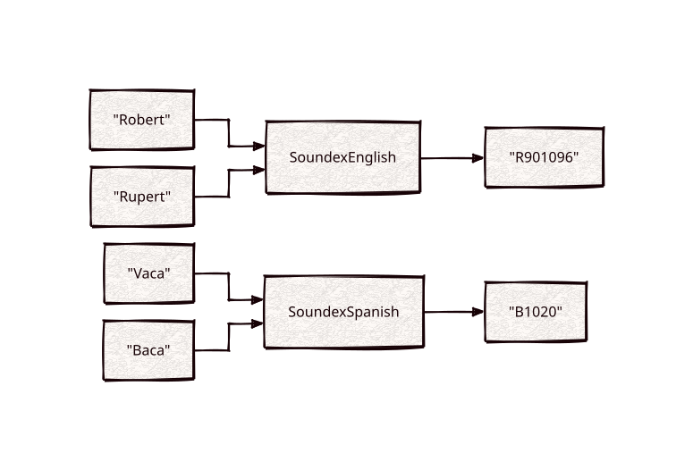

# soundex

Part of [Kronuz C++ Libraries](https://github.com/Kronuz/cpp-libraries), a collection of small, reusable C++ libraries.

[](https://github.com/Kronuz/soundex/actions/workflows/ci.yml)
[](LICENSE)


Phonetic codes for English, French, German, and Spanish in C++20: words that
sound alike collapse to the same code, so "Robert" matches "Rupert". For name
search, fuzzy matching, and deduplicating spellings.



## ✨ Highlights

- **Four languages**: refined Soundex (English), Soundex 2 (French), Kölner
  Phonetik (German), and a Spanish Soundex.
- **Refined, not truncated.** Codes keep vowels and full length, so they separate
  more words than classic four-character Soundex.
- **One interface.** Construct from a word and call `encode()`, or reuse an
  encoder with `encode(word)`.
- **Header-only**; the French, German, and Spanish encoders use
  [strings](https://github.com/Kronuz/strings) for upper-casing.

## 📦 Installation

Requires a C++20 compiler and CMake 3.14 or newer; it fetches strings. CI builds
it on Linux (x86_64, arm64), macOS (arm64, x86_64), and FreeBSD, plus ASan, UBSan,
and TSan builds.

```cmake
include(FetchContent)
FetchContent_Declare(soundex
  GIT_REPOSITORY https://github.com/Kronuz/soundex.git
  GIT_TAG        main)
FetchContent_MakeAvailable(soundex)

target_link_libraries(my_app PRIVATE soundex::soundex)
```

## 🚀 Quick start

```cpp
#include "english_soundex.h"
#include "spanish_soundex.h"

#include <cassert>

int main() {
	assert(SoundexEnglish("Robert").encode() == SoundexEnglish("Rupert").encode());   // R901096
	assert(SoundexSpanish("Vaca").encode() == SoundexSpanish("Baca").encode());       // B1020
}
```

[`examples/demo.cc`](examples/demo.cc) encodes word pairs in each language.

## 🎯 When to use it

- ✅ Matching names and words by sound within one language.
- ✅ Phonetic scoring with [string-similarity](https://github.com/Kronuz/string-similarity)'s
  `PhoneticMetric`.
- ❌ Compatibility with classic Soundex codes (`R163`): these are the refined
  variants.
- ❌ English with more nuance: [double-metaphone](https://github.com/Kronuz/double-metaphone)
  handles more spelling rules and alternate pronunciations.

## 📚 Documentation

- [docs/API.md](docs/API.md): the encoders, their references, and usage.
- [ARCHITECTURE.md](ARCHITECTURE.md): the CRTP base and each language's rules.
- [AGENTS.md](AGENTS.md): repository map and traps.

## 🛠️ Building and testing

```sh
cmake -B build && cmake --build build && ctest --test-dir build
./build/soundex_demo
```

## 🤝 Contributing

Issues and pull requests are welcome. Codes are stored in indexes, so encodings
must not change; read [AGENTS.md](AGENTS.md) first. CI must pass on every
platform.

## Performance note

`SoundexEnglish` encodes in one pass into a fresh string through a 256-entry class table
(`test/diff_test.cc` checks it against the original in-place erase/insert code over every
string up to four characters of a mixed alphabet plus random strings). `./build/soundex_bench`
times both.

## 📄 License

MIT, Copyright (c) 2015-2019 Dubalu LLC. See [LICENSE](LICENSE). Extracted from
[Xapiand](https://github.com/Kronuz/Xapiand).
